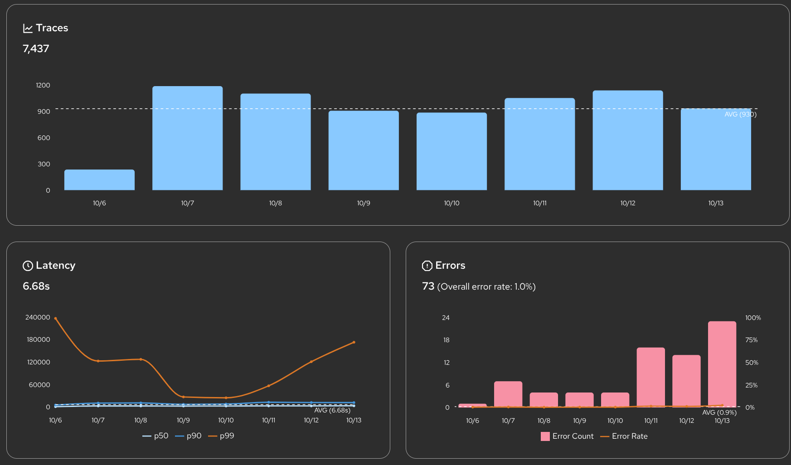

For a few weeks this summer I had a quiet theory about my own system, and the theory was that the model was flaky. The agents I run against the real book would come back with an empty answer, or a truncated one, or sometimes nothing at all, and I would do what you do when you believe the model is the weak part. I rewrote the prompt. I lowered the temperature. I told myself the 26B was just small enough to be moody, and I swapped a call or two down to a different model to see if it behaved. Some of that even seemed to help, in the way that any change seems to help when you can't actually see what you changed.

Then I put a trace on every model call, and the theory died in about an hour. The model was fine. The model had been fine the whole time. The thing that was flaky was the code I had wrapped around it, and the trace didn't just hint at that. It handed me the exact shape of my own mistake, counted it, and timestamped it.

## What I thought I was looking at

The setup is worth stating, because it's the thing that made me wrong. My agents don't call a frontier API. They call small models I serve myself, in my own cluster, on my own GPUs: a 26-billion-parameter Gemma doing the reasoning-heavy work, a 12B doing the quick summarizing, each pointed at a different job. When one of those loops disappoints you, the model is the obvious suspect, because the model is the part you didn't write and can't fully see. It is probabilistic, it is somebody else's weights, and it is sitting at the far end of a network call where anything could be happening.

So when the output was wrong, I debugged the model. I never once debugged the twelve lines of my own code between my agent and the predictor, because in my head those twelve lines were plumbing, and plumbing either works or it doesn't. It does not come back *subtly wrong*. That was the belief. It was the whole problem.

If you've read [Everything Is a Write Path](/p/everything-is-a-write-path/), you already know the shape of what I'd done, because I'd written two thousand words about it and then walked straight into it anyway. The read path is the hard half. I had excellent eyes on what my agents *decided* and no eyes at all on what they *asked*. I was grading the model's answers without ever once reading the question I'd sent it.

## The instrument

The fix for not being able to see is an instrument, and the instrument turned out to be sitting in the cluster already. There's a managed MLflow operator in the platform I run, stood up weeks earlier for the thing MLflow is nominally for, tracking training runs. I'd seen a demo of its tracing and asked, mostly idly, how hard it would be to get a trace on every agent call. The honest answer was: barely any work at all, for a reason I'll get to, so I did it.

What I ended up with is one MLflow experiment per agent loop. `hunt-agent`, `portfolio-loop-agent`, `aep-research-agent`, `weekend-brief-agent`, each a named drawer. Inside each drawer, one span per model call, and every span carries the things I'd been flying without: the model, the role it was playing, the `max_tokens` I'd allowed, the temperature, whether reasoning was on, the token counts, the latency, and the part that ended the argument, the **full prompt and the full completion, verbatim**. Because the whole thing lives inside my own cluster, I don't have to redact any of it. The exact bytes I sent and the exact bytes that came back, saved, searchable, forever.

Nearly seventy-two thousand of them now. The first thing I did was the dumbest possible query, which was to ask how many had failed, and the answer was about two thousand. A roughly three percent error rate, averaged, which I had been experiencing as "the model is moody" and had never once seen as a *number*. Then I grouped the failures by their error message, and the moodiness resolved into something much less flattering to me.



Even the overview panel tells the story before you drill in. The error bars sit near zero for most of the window and then rear up at the right edge, and the p99 latency line climbs with them. That is not a model getting dumber on a Tuesday. That is a dial moving, and until I had this I could not see the dial at all.

## The number that was mine

Here is the table that killed my theory.

| What the call said | Model | How many | What it actually was |
|---|---|---|---|
| `This operation was aborted` | 26B | **1,296** | my timeout, not the model |
| `HTTP 500` | 12B / Gemma | ~600 | the serving tier, overloaded |
| `HTTP 400` | 26B | 238 | a malformed request I built |

Start with the big one. Thirteen hundred calls died saying `This operation was aborted`, and when I pulled the durations, every single one of them had run for **exactly 300.0 seconds** before it died. Not around five minutes. Five minutes to the tenth of a second, over and over, thirteen hundred times.

A model does not fail on a stopwatch. A model fails raggedly, at whatever point it runs out of tokens or hits a bad sample. A perfectly flat 300.0-second cliff is not the model failing at all. It is *me* failing, in a `setTimeout`. I had a five-minute `AbortController` ceiling on the transport, a default I'd set and forgotten, and the 26B is a reasoning model. On a long document it will happily think for more than five minutes, and it was, and right at the moment it was about to hand me the answer, my own code reached in and killed it. Every truncated reply I'd blamed on the model was the model getting guillotined mid-sentence by a deadline I'd written.

The `HTTP 400`s were, if anything, more embarrassing. Two hundred and thirty-eight calls rejected before the model saw them, and when I opened one, the system prompt was `""`. Empty. A code path was building a request with no system message at all and firing it anyway, and the model, correctly, refused a malformed request. I had been blaming the mannequin for how badly it wore a suit I'd forgotten to put on it.

None of this was visible from logs. I had logs. Logs told me, line by line, that a thing had failed, and logs are exactly where a flat 300.0-second cliff goes to hide, because no single log line is the whole distribution. You cannot see a shape one event at a time. The trace gave me the shape, and the shape had my name on it.

> **Aside.** The model-serving package, the one part that could legitimately have blamed the model, was the one part that stayed silent the whole time. It owns no telemetry by design. It just answers and lets the caller be wrong in public. That restraint is the only reason the blame landed where it belonged.

## The half my customers actually ask about

I hear a version of this from customers constantly, and it is never "is the model correct." It's "are my GPUs being used well." They've bought the cards, the cards are expensive, and the entire game is keeping them humming near full but not past it. Under-utilized is money set on fire. Over-utilized is latency, timeouts, and a serving tier that falls over at the worst moment. They want the needle near the top of the dial and not buried past it, and the thing nobody tells them is that the needle is almost never really about the model. It's about how the code feeds it.

The same trace that told me my code was wrong is, read a second way, the most honest GPU-utilization instrument I have, because both edges of that dial are sitting right there in the error table.

The under-utilization edge is those 1,296 aborted calls. Add up the compute they burned and it comes to roughly **108 GPU-hours spent producing exactly zero tokens**. The card was pinned, thinking as hard as it thinks, fully utilized in the most useless possible way, because at the 300-second mark I threw the entire forward pass in the bin and asked for nothing back. That is the worst number in the whole system. It isn't an idle GPU, which at least costs you only opportunity. It's a *busy* GPU, at capacity, working on an answer no one would ever read.

The over-utilization edge is the `HTTP 500`s, and they tell their own story in time. On three ordinary days this week the error rate jumped from its usual sub-one-percent to nearly ten, and when I split those spikes by message they were almost entirely 500s from the serving tier, not aborts and not my 400s. That is the other failure mode exactly: not my code holding the model wrong, but too much of my code holding the model at once, and the server saturating past what it could carry. One signature means slow down or widen the lane. The other means my deadline is too short. They are opposite problems with opposite fixes, and from a log they look identical. They are the same word, "error," hiding two different dials. The span pulls them apart.

## Why it cost almost nothing

I want to be careful here, because the easy version of this post ends with "so I built observability," and that is not what happened. I didn't build much of anything. That's the part worth keeping.

The tracing is one decorator, wired in one place. It wraps the transport, the single chokepoint every model call already flows through, and it emits a span on the way past. The whole wrapper is this, and almost none of it is interesting:

```typescript
// Wrap the model transport with an `llm.call` span.
// Pure pass-through: identical resolved value on success,
// identical rejection on throw. The model never knows it's watched.
export function tracingTransport(inner: ModelTransport, tracer: Tracer): ModelTransport {
  return async (url: string, body: string) => {
    const span = tracer.startSpan('llm.call');
    try {
      span.setAttrs(requestAttrs(body));        // model, role, max_tokens, the prompt
      const response = await inner(url, body);  // the real call, untouched
      span.setAttrs(responseAttrs(response));   // tokens, latency, the completion
      if (response.status < 200 || response.status >= 300) {
        span.recordError(`HTTP ${response.status}`);
      }
      return response;
    } catch (e) {
      span.recordError(e instanceof Error ? e.message : String(e));
      throw e;                                   // never swallowed — the client needs it
    } finally {
      span.end();
    }
  };
}
```

That is the entire idea. It takes a transport and returns a transport of the exact same shape, so the agent calling it cannot tell the difference. On the way through it opens a span, writes down what went out and what came back, marks the span failed on a non-2xx or a throw, and always closes it. The one rule it will not break is in that `catch`: it records the error and *re-throws it unchanged*, because the model client downstream relies on a thrown transport to degrade honestly, and a tracer that quietly ate failures would turn "the call failed" into "no failure happened," which is the single shape this thing must never produce. Every one of those 1,296 aborts and 238 bad requests walked through exactly this function, got written down, and continued failing precisely as it would have without me watching.

I did not touch the model-serving code. Not one line. The package that actually talks to the GPU has a standing rule that it owns no telemetry, and the trace respected that rule completely by living one layer up, at the seam, where my code hands the request off. When MLflow isn't wired, the tracer is a no-op and the whole system behaves exactly as before. The observability is not *in* the hot path. It's a clamp around it.

That's the detail I'd press on if you take one thing from this. The reason it was cheap is that every model call in my system already went through a single door, so there was exactly one place to hang the instrument. If those calls had been scattered across a dozen call sites, each with its own fetch and its own quiet five-minute timeout, there would have been no clamp to apply and no shape to see, and I'd still be out here lowering the temperature and telling myself the model was moody. The seam made the eyes cheap. The architecture I'd griped about building is the only reason the fix was a decorator and not a rewrite.

## What it didn't fix

I raised the timeout, made it tunable per call site instead of one global five-minute guess, and gave the heavy reasoning passes the half-hour they actually need. The abort cliff is gone. I fixed the empty-prompt path. The 500 spikes I can now at least *see*, which is not the same as having solved them, and I want to be straight about that gap rather than paper it.

Because what I have is a rear-view mirror, not a governor. The trace tells me, after the fact and beautifully, that I wasted a hundred GPU-hours last month. It does not stop me wasting them next month. The honest next step is to turn these spans into live signal, a p95 latency and a token-cost-per-lane I can actually watch while the agents run, and eventually a throttle that reads the 500 rate and backs off before the serving tier buckles instead of after. That doesn't exist yet. Today this is forensics, not control.

And I'm using it for the narrow thing, deliberately. Reading what the models get hit with, and fixing my code to hit them better. Not fine-tuning. People see full prompts and completions captured for seventy thousand real calls and immediately start talking about training data, and that's a real road, but it's a long way down from where I am. Right now the prompts and completions are evidence, and the only case they're being used to prove is that the problem was me.

The model was fine. It was fine the entire time I spent accusing it, which is the part that stings and the part that's worth writing down. The weakest component in my system was the twelve lines I'd been too sure of to look at, and the only reason I ever found out is that I finally put a trace on the one thing I'd never thought to watch, which was my own half of the conversation.
