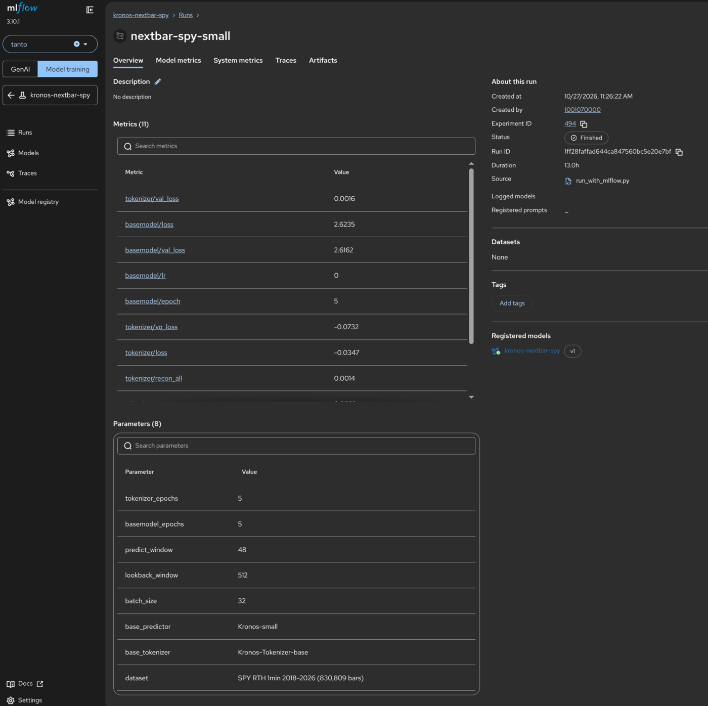
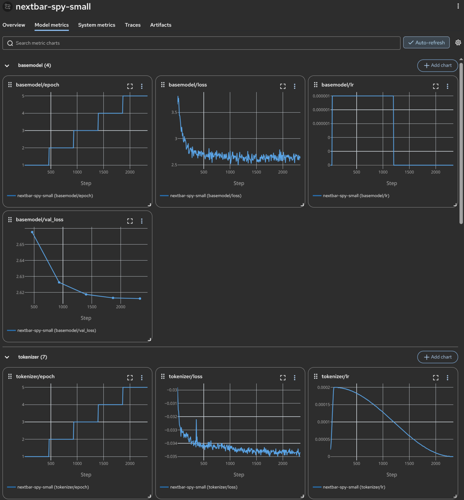

I wanted a number. Not a dashboard, not a feeling, a number: given the bars so far, does the next one-minute SPY bar close up or down. I had a foundation model that spoke fluent candlestick, I had eight years of my own SPY data, and I had the obvious idea that if I fine-tuned the first on the second, it would learn my instrument and start telling me which way the next bar leaned. I was confident enough in that idea to spend a night of GPU time on it.

By morning it was telling me, 50.3% of the time, which is the number you get from a coin that has heard of SPY.

I want to walk the whole thing anyway, because the interesting part is not that I was wrong. I'm wrong in most of these posts. The interesting part is how *cheap* being wrong turned out to be, and the thing that made it cheap was not cleverness on my end. It was Red Hat AI Enterprise (**RHAIE**), the platform the experiment ran on, doing the boring custodial work I would otherwise have done badly by hand.

## The one model that isn't the wrong shape

Most of the time-series foundation models you can download are univariate. You hand them one channel, a single series of numbers, and they forecast that series forward. For a candle strategy that is the wrong shape before you even start, because the thing my strategy keys off is the *joint* behavior of a bar: where the close sits relative to the high, the low, and the volume that printed them. Feed a univariate model the closes and you have thrown away the candle.

Kronos is the exception, and it is the exception on purpose. Its native unit is the whole OHLCV candle, tokenizer and decoder-only transformer, and it comes in sizes small enough to be honest about. I used `Kronos-small`, which is 24.7 million parameters. Not a large model. A model you can fine-tune on one aging consumer GPU overnight, which is exactly the point of this estate.

Customizing it for SPY meant three unglamorous things. Decode eight years of one-minute bars into the CSV shape Kronos wants. Shape them so the model never learns a lie. And feed only the channels it can actually trust.

That middle one bit first. Kronos reads consecutive rows as consecutive bars, so if you hand it all-hours data with the thin premarket and after-hours minutes missing, it quietly learns that a fourteen-hour overnight gap is a single one-minute step. So I fed it regular-hours-only, nine-thirty to four, dense with no holes. The last channel bit too: the volume in my feed is single-venue Nasdaq, not the consolidated SPY tape, and SPY is Arca-listed, so the prices are fine and the volume is a half-truth. Knowing which of your own columns is lying to you is most of the work, and it is the half nobody fine-tunes away.

## The part RHAIE made boring

Here is the stretch I expected to hate and didn't. The run itself was about thirty-nine minutes an epoch over the regular-hours bars, a handful of epochs, the kind of thing you start after dinner and read over coffee. None of that is the part worth the screenshots. The part worth the screenshots is that I didn't have to watch it.

I did not touch Kronos's training loop, not one line. The model's own code already narrates itself to a log as it goes, every epoch and every step, the tokenizer's reconstruction loss and the base model's training loss and the learning rates scrolling past. All the wrapper I ran it through, `run_with_mlflow.py`, does is attach a listener to that log. It reads the lines the trainer was always going to print, picks out the ones carrying a number, and hands each one to the MLflow experiment on RHAIE as a tracked metric. The training code has no idea it is being watched. It thinks it is talking to a log file, and it is, and the log file is quietly feeding a chart I can open in a browser.

The one genuinely fiddly bit was authentication, and I'll name it because it is exactly the kind of thing that kills a six-hour run at hour three for a stupid reason. RHAIE's MLflow authenticates every request with a short-lived cluster token that rotates out from under you about once an hour. Grab that token once at the start and bake it in, and the run dies at the first rotation, halfway, GPU still warm, nothing saved since. So the wrapper reads the token fresh on every request, straight off the file the cluster keeps current, and the run rides through as many rotations as it needs. Once that was right I stopped thinking about it, which is the highest compliment I give infrastructure.

That sounds like a small convenience. It is not. The reason I spent a GPU-night on a bad idea *once before* and didn't find out it was bad until the night was gone is that the experiment wasn't instrumented, so the only way to judge it was to wait for the end and squint. An experiment you can read while it runs is an experiment you can kill while it runs. The loss curves came down cleanly, the tokenizer learned the candle vocabulary, the base model tracked it, and every number said the training itself was healthy.

The training was healthy. That is a different claim from the model being any good, and conflating the two is the oldest trap in this whole field.

## Run the test that can embarrass you first

Before I trusted a single prediction, I made the model clear a bar that a potted plant could clear. For next-bar direction that bar is a coin: 50%, the up-down base rate, and last bar's sign carried forward. If the fine-tuned model can't beat a coin, it *is* a coin, however impressive the loss curve looked on its way down.

I also loaded the un-fine-tuned base model and scored it on the exact same windows, because there is a specific, humbling failure where your fine-tune ends up *worse* than the model you started from. It happens when the recipe retrains the tokenizer hard while leaving the predictor's learning rate a hundred times smaller, so the tokenizer moves the vocabulary out from under a predictor that barely budges, and the two fall out of alignment. The tuned model comes out biased and overconfident, a confident liar where the base was at least an honest one. You only catch it by scoring both.

And I confirmed at scale, because a hit rate on two hundred bars is a rumor. A slice that looked like 58% on a few hundred bars melted to 50-point-nothing by the time I had ten thousand of them under it.

## The coin flip, stated plainly

Fine-tuned Kronos-small, next-bar direction, out of sample, around ten thousand bars: 50.3%. Below the majority-class baseline. And flat across its own confidence, which is the detail that ends the argument. When I sorted its predictions from least to most confident, the bars where it was most sure were no more right than the bars where it shrugged. There was no high-conviction subset to trade, no corner of the distribution where the signal hid. The thing was a coin all the way down, and it knew the price of SPY while being one.

That is a real result. It is not a bug, a bad seed, or a thing another epoch fixes. Bar-level direction, at least this way, on this instrument, carries no edge, and the honest conclusion is not "try the next model." It is that the question was wrong.

## It was never an oracle. It's a cone.

The reframe is the only part I'd call progress. I had been asking Kronos "up or down," a point, a single committed guess about one unknowable bar. That is the one question the shape of the problem forbids, because the move that resolves it hasn't printed yet. What a stochastic model like this is actually built to answer is "what's the *spread* of where price could go from here," a cone of sampled paths rebuilt every bar, the model's honest picture of its own uncertainty.

Whether that cone is worth anything is the next question, and I'm not going to pretend I've answered it. A cone only earns its GPU if it beats the trivial one you get from a driftless random walk with the recent volatility plugged in, scored the boring honest way on calibration and sharpness. That test is still open. I'd rather leave it open on the page than close it with a sentence that sounds like a win.

## What the night actually bought

The model was wrong. I want to be precise about what that cost, because the number is the whole argument. It cost one night on one already-paid-for GPU, fully instrumented, reversible, with every epoch sitting in an experiment I can reopen a year from now to remember exactly how wrong and in what shape. It did not cost a week of me re-running an un-tracked job and trusting my memory of the last one.

The platform was the hero of a story where the model was the disappointment, and I've come to think that is the normal case and not the sad one. Most ideas in this work are coins. The ones that pay are the few that clear the baseline, and you find them by burning through the coins fast enough that a dead one is an evening, not a quarter. RHAIE made a dead idea an evening. I'll take a coin flip by morning over a hunch I never got to test, every time, and I went into this sure the model would be the interesting part. The tooling was.

I've [said the shape of this before from the other direction](/p/the-model-was-fine/): the day I put real instrumentation on a model was the day the model stopped getting blamed for things that weren't its fault. This time the instrumentation had nothing to exonerate. It just told me, cleanly and by morning, that I'd backed a coin. That is the tool working. The answer being "no" is not the tool failing, it is the only thing I actually paid for.
